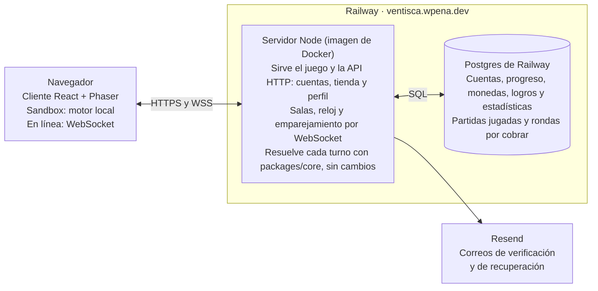

# Ventisca en línea (v2): PRD de multijugador, cuentas y progreso

Versión 1.18: aprobada para implementar · 13 de octubre de 2026 · William Andrés Peña Vargas

> Documento aprobado en claude.ai el 29 de septiembre de 2026. Desde ahora esta es la versión de referencia: los cambios se hacen aquí, en el repositorio. En todo lo que toque el modo en línea, este documento manda sobre `docs/PRD.md`.
>
> Cambios: la versión 1.1 agrega la gestión de la cuenta (R-43 a R-49 y D-57), aprobada el 29 de septiembre de 2026. La 1.2 (30 de septiembre de 2026) agrega las decisiones D-51 a D-56, tomadas al empezar el M7, la 1.3 (el mismo día) agrega D-58, tomada al desplegar, la 1.4 agrega D-59, aprobada con las cuentas del servidor, la 1.5 registra cómo se envían los correos y agrega R-50, D-60 y D-61 con las cuentas del servidor, la 1.6 agrega D-62, el correo de contacto, y una tarea del M9 para avisar los cambios del aviso de privacidad, la 1.7 (1 de octubre de 2026) agrega D-64: cada push a `main` se despliega, la 1.8 (el mismo día) corrige su causa: los despliegues se saltaban por las rutas vigiladas del panel de Railway, no por las de `railway.json`, la 1.9 agrega D-65, la comprobación de origen, y D-66, las compras en el libro de monedas, y precisa las tablas del progreso, la 1.10 agrega D-67, el perfil como inicio en línea durante el M7, y D-68, el reintento de una compra en el cliente, y marca el progreso en la cuenta del M7, la 1.11 anota que P-20 ya está medida, la 1.12 (6 de octubre de 2026) cierra P-20 con R-51 y las decisiones D-69 a D-72, precisa D-68, agrega D-73, sobre los dispositivos, y anota lo que queda pendiente antes del M8, y la 1.13 (el mismo día) agrega D-75: Ventisca deja de ser un proyecto de clase y es el piloto de un proyecto personal. El primer párrafo del aviso de privacidad cambia como corrección previa a la apertura, sin aviso previo, porque todas las cuentas siguen siendo internas. También anota, como idea para después y sin compromiso, que las ayudas de las partidas locales podrían ofrecerse en línea (`docs/ideas/`). La 1.14 (el mismo día) pone esa nota en presente: las ayudas ya existen en las partidas locales, con su decisión (D-78, en `docs/PRD.md`). La 1.15 (12 de octubre de 2026) registra el multijugador en línea, que se publica como Beta: las decisiones D-83 a D-103, las reglas R-52 a R-55, y las enmiendas a R-33 a R-42. Cambian el reloj (10 s, D-90), la desconexión (el ninja queda quieto, D-92), el abandono (pierde las monedas de la partida, D-93) y el reinicio del servidor (la partida en curso se pierde, D-94), que reemplazan a D-46, D-45, D-31 y D-49. El M8 y el M9 se entregan juntos (D-84). La 1.16 (13 de octubre de 2026) cierra la Beta: pone al día los hitos M8 y M9 con lo que se entregó y lo que quedó para después, y anota en D-96 lo que precisó la revisión del aviso de privacidad. La 1.17 (el mismo día) registra los ajustes que salieron de la primera prueba de la Beta: el amuleto de 4 pliegues, con 12 logros por ninja y con contadores (D-104), el avance siempre a la vista y "Mis cartas" por elemento (D-105), el aviso de mazo agotado (D-106) y cómo se cuenta cada logro, con sus metas (D-107). Enmienda R-55 y, de `docs/PRD.md`, R-29; D-102 y D-103 pasan a aprobadas. Cierra para la Beta P-25, sobre los logros que dependen de caer, y abre P-26, sobre las defensas contra el abuso del juego en línea. La 1.18 (el mismo día) registra los vínculos discretos al portafolio de quien hace Ventisca (D-108): su nombre en el pie de la portada, su sello en la esquina de enfrente y la última línea de los créditos.

## Resumen y alcance

Ventisca v2 agrega un modo en línea con cuentas: de 2 a 3 personas juegan juntas, cada una con un ninja, y solo ese modo da progreso.

- **Sandbox (modo solo):** siempre disponible y sin cuenta. Una persona controla a los tres ninjas con un mazo fijo. No da monedas, cartas, logros ni estadísticas.
- **En línea:** requiere cuenta con correo y contraseña. Hay salas con código para jugar con amigos y emparejamiento público. Monedas, cajas, colección, logros y estadísticas viven en la cuenta.
- **Dónde:** en ventisca.wpena.dev, todo alojado en Railway (Docker, servidor Node y Postgres), con correos por Resend.

- **Beta:** el modo en línea se publica como Beta para todas las cuentas verificadas (D-83), con la cola pública y las salas con código (D-84), solo en Clásica (D-85).

Queda fuera de v2: chat, señales y clasificaciones públicas. El jefe final y los rangos siguen en v3. El motor de reglas no cambia: el servidor usa el mismo `packages/core`.

## Decisiones

Las decisiones están cerradas. De las diecisiete del documento aprobado, ocho se tomaron al definir la idea y nueve se aprobaron tras revisarlas una por una. Después llegaron D-57, la gestión de la cuenta; D-51 a D-56, tomadas al empezar el M7 (las herramientas del servidor se explican en el ADR 0006), D-58, tomada al desplegar, D-59, D-60 y D-61, aprobadas con las cuentas del servidor, D-62, el correo de contacto, D-64, que despliega cada push a `main`, D-65, la comprobación de origen, D-66, las compras en el libro de monedas, D-67 y D-68, aprobadas con el progreso en el cliente, D-69 a D-72, que cierran P-20, D-73, sobre los dispositivos, y D-75, que deja de llamar a Ventisca proyecto de clase (D-74 y D-76 a D-82, la claridad del tablero y los créditos, están en `docs/PRD.md`). D-83 a D-101 son las del multijugador en línea, dictadas por el dueño de producto el 12 de octubre de 2026 con sus maquetas aprobadas; D-102 y D-103 se tomaron al implementarlo, y el dueño de producto las aprobó al revisar el PR #29. D-104 a D-106 son los ajustes que dictó el 13 de octubre de 2026, tras la primera prueba de la Beta, con sus maquetas aprobadas; D-107 se tomó al implementarlos, y la aprobó ese mismo día, al revisar el PR #30, con un cambio: qué cuenta "Nadie se queda atrás". D-108, los vínculos a su portafolio, la dictó ese mismo día. Desde D-83, las decisiones nuevas se registran aquí, y `docs/PRD.md` solo las enlaza. La columna de estado queda como registro de cómo se decidió cada una.

| ID | Decisión | Estado |
| --- | --- | --- |
| D-34 | Dos modos: sandbox sin cuenta ni progreso, y en línea con cuenta, el único que da progreso. La progresión de R-25 a R-32 pasa del navegador a la cuenta. | Tomada |
| D-35 | Partidas en línea de 2 o 3 personas, un ninja cada una. Con 2, el bot controla el tercero. Nunca una sola persona: sin compañero no hay partida en línea (P-24). | Tomada |
| D-36 | Salas con código y emparejamiento público, las dos desde el inicio. | Tomada |
| D-37 | Todo en Railway con Docker: servidor Node autoritativo en el monorepo y Postgres. Reemplaza el plan de Cloudflare Durable Objects (§11) y el workflow de despliegue a Cloudflare. | Tomada |
| D-38 | Cuentas con correo y contraseña. Verificación y recuperación por correo con Resend. Sin límite de edad: el juego es para todo el mundo, sin verificación de edad ni autorización de adultos en v2 (P-19). | Tomada |
| D-39 | Estadísticas de combate solo del modo en línea, calculadas en el servidor. Son privadas: solo las ve cada jugador (P-21). | Tomada |
| D-40 | Dominio ventisca.wpena.dev, con un registro CNAME hacia Railway. | Tomada |
| D-41 | Público abierto en internet. | Tomada |
| D-42 | Sin comunicación, como el original: ni chat ni señales. Cada persona ve en tiempo real el plan de sus compañeros (R-35). | Aprobada |
| D-43 | Elección de ninja, como el original: cada persona elige su ninja antes de entrar a la cola, y el emparejamiento solo junta personas con ninjas distintos. En una sala, cada quien elige sin repetir. | Aprobada |
| D-44 | El emparejamiento espera 30 s a un tercer jugador. Después, las dos personas pueden empezar con un bot si ambas aceptan; mientras tanto, la búsqueda sigue. | Aprobada |
| D-45 | Si alguien se desconecta, el bot toma su ninja hasta que vuelva. | Reemplazada por D-92 |
| D-46 | Reloj del servidor, sin pausa: todos planifican a la vez, con 15 s por turno (el original usaba 10 s). Enmienda R-04 para el modo en línea. | Aprobada; los 15 s, reemplazados por los 10 s de D-90 |
| D-47 | El bot juega con el mazo de referencia de su elemento: 8, 9, 10, 10, 11 y 12. | Aprobada |
| D-48 | Recompensas individuales: cada persona cobra sus rondas (D-31) y gana sus logros. Solo cobra una ronda quien estaba conectado al terminarla; el bot no cobra. | Aprobada |
| D-49 | El estado de cada partida se guarda en Postgres al final de cada turno, para reconstruir las salas tras un reinicio. | Reemplazada por D-94 |
| D-50 | El sandbox usa por ninja el mazo de referencia del balance (8, 9, 10, 10, 11 y 12). El mazo de una cuenta nueva, con un solo 9, apenas permite combos. | Aprobada |
| D-51 | El servidor HTTP y de WebSocket usa Fastify (ADR 0006). | Tomada |
| D-52 | El servidor usa Postgres a través de Drizzle. drizzle-kit genera las migraciones como SQL versionado en el repositorio, y se aplican al desplegar (ADR 0006). | Tomada |
| D-53 | Los mensajes del protocolo y las entradas de la API se validan con esquemas de Zod, compartidos por cliente y servidor en `packages/protocol` (ADR 0006). | Tomada |
| D-54 | Las contraseñas se guardan con Argon2id mediante @node-rs/argon2 (ADR 0006). | Tomada |
| D-55 | El progreso guardado en el navegador en v1 (camino, monedas, colección y logros) se descarta: no pasa a la cuenta, y el sandbox deja de usarlo. Los ajustes no son progreso y se conservan. | Tomada |
| D-56 | Borrar la cuenta borra la fila del usuario junto con sus sesiones, sus códigos y su progreso: perfil, colección, libro de monedas, logros y estadísticas. Su lugar en `match_players` queda anónimo, como el del bot. | Tomada |
| D-57 | Gestión de la cuenta con códigos de 6 dígitos que vencen en 15 min en todo lo que pasa por el correo, en lugar de enlaces. Contraseña de 8 a 128 caracteres con mayúscula, número y símbolo, más una lista de contraseñas comunes. Cambiar la contraseña con la sesión iniciada solo pide la actual (R-43 a R-49). | Aprobada |
| D-58 | El dominio del juego va en "Solo DNS", sin el proxy de Cloudflare: el CNAME apunta directo a Railway, que sirve el certificado. Con el proxy, Cloudflare ve todo el tráfico, inyecta su analítica en la página y agrega reportes de red hacia sus servidores, y nada de eso está declarado en el aviso de privacidad. `pnpm check:prod` lo comprueba. | Tomada |
| D-59 | Las cuentas no revelan qué correos están registrados. Registrarse y pedir un código responden igual exista o no la cuenta; si ya existía, su dueño recibe un aviso por correo. Iniciar sesión con un correo sin cuenta o con la contraseña equivocada da el mismo error y tarda lo mismo. El nombre ocupado se revisa antes que el correo, para no delatarlo. Rige también para los límites de intentos y la recuperación de la contraseña. Sin sesión, un código que no sirve (equivocado, vencido o agotado) responde siempre lo mismo: decir cuántos intentos quedan delataría la cuenta. | Aprobada |
| D-60 | Un cambio de correo se puede deshacer desde el correo anterior durante 7 días con un código (R-50), porque la recuperación (R-46) mandaría el código al correo nuevo. Deshacerlo pide una contraseña nueva, porque quien hizo el cambio conocía la anterior. | Aprobada |
| D-61 | El límite por IP sube a 50 intentos fallidos cada 15 min; el de 5 por cuenta sigue. Un salón de clase puede salir a internet por una sola IP. Solo cuentan los fallos. | Aprobada |
| D-62 | El correo de contacto del aviso de privacidad es ventisca@wpena.dev: Cloudflare Email Routing lo recibe en wpena.dev y lo reenvía al buzón del responsable, y el aviso lo declara. ventisca.wpena.dev no recibe correo: la recepción de Resend pediría un MX en ese nombre, que choca con el CNAME del juego. | Tomada |
| D-64 | Cada push a `main` se despliega, toque lo que toque: `pnpm check:prod` exige que producción corra el último commit de `main`, y con una lista de rutas vigiladas un PR solo de documentación la dejaría atrás a propósito. Por eso `railway.json` no lleva `watchPatterns`. `railway.json` es la fuente de verdad del despliegue, y en el panel de Railway deben quedar vacíos "Watch Paths", "Custom Build Command", "Custom Start Command" y "Root Directory", porque el panel puede pisarla sin que se note. Así pasó: las "Watch Paths" que dejó la importación del monorepo (`/apps/server/**`) hicieron que Railway saltara los despliegues de los PR #12 y #13, que solo tocaban `apps/web/` y documentación. | Tomada |
| D-65 | Las peticiones que cambian estado solo se aceptan desde el propio juego: deben traer el `Origin` de `APP_URL`. La cookie de sesión es `SameSite=Lax`, pero para `SameSite` todo wpena.dev es el mismo sitio, así que viaja en las peticiones que mande una página de cualquier otro subdominio; el origen sí las distingue, y una página no puede falsificarlo. Sin `Origin` decide `Sec-Fetch-Site`, y sin ninguna de las dos cabeceras la petición pasa, porque no viene de un navegador y no lleva la cookie de nadie. | Aprobada |
| D-66 | El libro de monedas registra también los gastos. Cada compra de caja deja un movimiento negativo con un identificador de compra que genera el cliente, único por cuenta, y con las cartas que salieron. Si llega un reintento con el mismo identificador, el servidor devuelve el resultado original, guardado en ese movimiento, y no cobra de nuevo: así una respuesta perdida no compra dos cajas. No hace falta una tabla nueva, y el saldo es siempre la suma del libro. | Aprobada |
| D-67 | Durante el M7, el perfil hace de inicio en línea: muestra el resumen del progreso (camino, monedas, cartas por elemento y cajas abiertas) y su botón primario lleva a la colección y la tienda. Elegir la carta de camino se puede dejar para después: el perfil lo recuerda y, mientras falte, cada vez que la persona entra llega a elegirla. "Jugar" se suma al inicio con el M8, y las estadísticas, con el M9. | Aprobada |
| D-68 | El cliente conserva el identificador de una compra (D-66) solo si su respuesta se pierde. Entonces no se sabe si el servidor cobró: comprar de nuevo la misma caja, con el mismo elemento y tamaño, es un reintento y lleva el mismo identificador; otra caja es otra compra, con uno nuevo. Un error 500 del servidor cuenta como respuesta perdida, porque no dice si se cobró. Con cualquier respuesta definitiva del servidor, sea el éxito o un error como `not_enough_coins`, el identificador se borra. Tras una respuesta perdida, el cliente vuelve a leer el progreso para mostrar el saldo real. También lo vuelve a leer tras un rechazo por monedas insuficientes, para que el saldo en pantalla no quede viejo (esto último llega con el próximo PR del cliente). Mientras espera la respuesta, los botones de compra quedan deshabilitados. | Aprobada |
| D-69 | Tormenta en línea pide un mínimo de cartas: 5 del elemento del ninja con que la persona entra, tanto en el emparejamiento público como en las salas con código (R-51). La pantalla muestra cuánto falta y sugiere jugar Clásica para conseguir la primera caja. Medido en P-20: con ese mínimo, el peor equipo gana el 79 %; sin él, una sola persona nueva baja a un equipo de colecciones completas del 93 al 73 %, y al 58 % si lleva a Nieve. | Aprobada |
| D-70 | El emparejamiento junta a cualquiera dentro de la dificultad elegida. Con pocas personas jugando, más filtros solo alargan la espera. El mínimo para Tormenta (R-51) se pide al entrar a la cola. | Tomada |
| D-71 | El límite de turnos del bonus se queda en 13 en Clásica y 18 en Tormenta (D-12), también en línea. Medido en P-20: en los equipos donde cada persona tiene al menos una caja, del 65,5 al 68,2 % de las partidas de Clásica y del 43,9 al 45,9 % de las de Tormenta superan la ronda 3 dentro del límite, casi lo mismo que con el mazo de referencia (64,1 y 44,7 %). | Aprobada |
| D-72 | Se acepta que Clásica en línea sea fácil desde la primera caja (99,7 % de victorias en el simulador): es el modo para empezar, y el simulador es un techo para personas reales. | Tomada |
| D-73 | El juego debe funcionar en computador y en teléfono, por etapas. El combate en línea del M8 se diseña para computador. Las pantallas nuevas del M8 (sala, cola y equipo en línea) se construyen adaptables desde el principio, con diseño fluido y no dentro del escenario fijo de 1280×720. El alcance del teléfono se decide con una investigación, que queda pendiente. | Tomada |
| D-75 | Ventisca ya no es un proyecto de clase: es el piloto de un proyecto personal, que su responsable avanza en sus ratos libres. El aviso de privacidad lo dice en su primer párrafo, que nombra de forma explícita al responsable del tratamiento de los datos, y declara que hoy el juego es gratuito: no vende nada ni muestra publicidad. Todas las cuentas siguen siendo internas, así que el cambio del aviso va como corrección previa a la apertura, sin aviso previo, y su "Vigente desde" pasa a la fecha de la fusión. Desde que haya cuentas de otras personas, cualquier cambio del aviso pasará por el mecanismo del M9. | Tomada |
| D-83 | La Beta del modo en línea se abre a todas las cuentas verificadas. "Jugar en línea" lleva la etiqueta "Beta". | Tomada |
| D-84 | La Beta trae desde el primer día las dos formas de jugar de D-36: la cola pública y las salas con código. El M8 y el M9 se entregan juntos. | Tomada |
| D-85 | En la Beta solo se juega Clásica. Tormenta en línea queda para después, con su mínimo de 5 cartas por elemento ya decidido (R-51). | Tomada |
| D-86 | Además de jugar, la Beta da monedas por ronda, logros, con el doble de monedas al completar los 9, y estadísticas privadas básicas en el perfil: partidas, rondas y victorias. El resto de las estadísticas de R-42 llega después. | Tomada |
| D-87 | El ninja se elige en cada partida, como en el original. La pantalla ofrece primero el del camino de la persona, y se juega con la colección del elemento del ninja elegido. Precisa D-43 y R-34: el camino ya no fija el ninja. | Tomada |
| D-88 | Cola incompleta: con dos personas, a los 30 s se les ofrece el bot como tercero, y la partida empieza cuando ambas aceptan. Mientras tanto la búsqueda sigue: si llega una tercera persona, la partida empieza con ella. Quien cancela sale de la cola, y una persona sola sigue esperando (D-35 y D-44). | Tomada |
| D-89 | En una sala, quien la crea puede empezar con dos personas: el bot toma el ninja libre. Con tres, empieza la partida completa. | Tomada |
| D-90 | El reloj da 10 s por turno, como el original. Reemplaza los 15 s de D-46 y enmienda R-36. Se revisa tras la prueba de la Beta. | Tomada |
| D-91 | Sin comunicación, como el original (D-42). Los compañeros se coordinan viendo los planes de los demás, que llegan en tiempo real con las mismas marcas del tablero. Cuando dos o más ninjas planean carta, sus miniaturas llevan el borde dorado y la franja lo anuncia: sin chat, esa señal es la forma de coordinar un combo. | Tomada |
| D-92 | Si alguien se desconecta, su ninja queda quieto hasta el final de la partida, como en el original. Reemplaza a D-45: el bot ya no toma el ninja de nadie, y solo completa el asiento que quedó libre al empezar. Si su dueño vuelve, lo retoma desde el turno siguiente. Si se van todas las personas, la partida termina. | Tomada |
| D-93 | Abandonar es salir con el botón "Salir", que pide confirmación, o desconectarse y no volver antes del final. Quien abandona pierde las monedas de esa partida: las de cada ronda quedan pendientes y se acreditan al terminarla. Reemplaza en el modo en línea a D-31 (`docs/PRD.md`) y a la R-39 anterior, y responde P-22 para la Beta. | Tomada |
| D-94 | Si el servidor se reinicia, la partida en curso se pierde. Reemplaza a D-49: el estado ya no se guarda por turno ni se reconstruyen las salas. Se acreditan las monedas de las rondas ya terminadas, y la partida no cuenta como abandono ni como derrota. | Tomada |
| D-95 | La Beta se publica sin interruptor: queda abierta al fusionar su PR, cuando nadie esté jugando. | Tomada |
| D-96 | Antes de publicar la Beta se revisa que el aviso de privacidad cubra todo lo que hace el multijugador, y lo que falte se corrige en el mismo PR. Después, el aviso queda congelado hasta que exista el mecanismo para avisar sus cambios, que llega después de la Beta. **Revisado el 13 de octubre de 2026:** el aviso ya nombraba las partidas, los logros y las estadísticas, y se precisaron tres cosas. El nombre visible lo ven también las personas con quienes se busca equipo. De cada partida se guardan, además del ninja y de cuándo se entró y se salió, las rondas superadas y cómo terminó para la persona. Y mientras se juega, el equipo ve lo que cada quien planea y si sigue conectado, y eso no se guarda. | Tomada |
| D-97 | Teléfono: las pantallas nuevas del modo en línea que están fuera del combate son adaptables. El combate en línea es para computador (D-73). | Tomada |
| D-98 | El logro "Tormenta perfecta" (golpear a 3 gólems con una carta) pasa a llamarse "Barrido perfecto", para que nadie crea que pide jugar en Tormenta. | Tomada |
| D-99 | Toda pantalla se compone sobre una grilla de 12 columnas a 1280×720, con 16 px entre columnas, 56 px de margen y ritmo vertical de 8 px. Tiene cuatro plantillas (menú, batalla, lectura y diálogo) y reglas de simetría, de respiro y de detalles. En las pantallas adaptables pasa a 8 columnas entre 600 y 1023 px, y a 4 por debajo de 600. Está en la sección 12 de `docs/lineamientos-de-diseno.md` y, como variables, en el código. | Tomada |
| D-100 | Las pantallas del modo en línea toman la estructura del original donde la hay: la ficha para elegir ninja, la búsqueda de equipo, la carga, el combate y los resultados. Las salas con código y los avisos son propios. La Libreta ninja, con las pestañas "Mi progreso" y "Mis cartas", reemplaza a "Tu progreso" y a "Colección y tienda", y muestra el amuleto de papel: tres pliegues, que se colorean al completar los tres logros de cada uno. | Tomada |
| D-101 | El bot, al revivir, mira si quien revive podría caer, no solo si un gólem lo alcanza: suma el golpe más fuerte de cada gólem que llega a su casilla, descuenta uno si tiene Escudo y lo compara con su vida. Un ninja con mucha vida aguanta el golpe y completa la reanimación. Medido con el simulador (`docs/balance-report.md`): en Tormenta, con el mazo de referencia, el bot pasa de 0,66 a 1,48 reanimaciones por partida, pierde casi las mismas (del 2,6 al 2,9 %) y la victoria sube del 91,5 al 95,9 %. En Clásica, que ya se ganaba, sube 1,2 puntos con la colección de inicio. Las decisiones de P-20 no cambian. | Tomada |
| D-102 | Cómo corre una partida en el servidor. Una sola conexión WebSocket por persona, en `/api/play`, que pide sesión, correo verificado y el `Origin` del juego; una conexión nueva de la misma cuenta reemplaza a la anterior. Cada persona recibe el estado sin el azar de la partida y sin las manos de los demás. Cada plan se valida al llegar con el motor: si dos personas quieren la misma casilla o el mismo caído, vale el que llegó primero y a la otra se le avisa. Confirmar es definitivo en ese turno. El reloj del turno empieza cuando todas las personas terminaron de ver el turno anterior, con un tope. | Aprobada |
| D-103 | Recompensas por persona. Cada logro se otorga en el momento en que ocurre y a quien está conectado, así que se mantiene aunque después abandone. Los personales miran lo que hizo su ninja; los de equipo se dan a quienes están conectados cuando pasan. Al acreditar las monedas se cuentan los logros ya guardados, incluidos los de esa partida: completar el amuleto duplica ya ese pago. En las estadísticas, la partida abandonada cuenta como jugada y no ganada, la perdida por un reinicio no cuenta, y las rondas superadas cuentan siempre. | Aprobada |
| D-104 | El amuleto de papel tiene 4 pliegues y 12 logros, tres por pliegue, y cada logro lleva un contador. Salió de la primera prueba de la Beta: los 9 logros se ganaban una sola vez y con cualquier ninja, así que jugando con Escarcha y Brasa se completó el pliegue de Agua, y 8 de los 9 cayeron en cinco partidas. **Los pliegues.** Los de Fuego, Agua y Nieve se ganan jugando con Brasa, Marea y Escarcha; el del centro, Equipo, con cualquier ninja. Es fiel al original, cuyo amuleto tenía una cuarta piedra en el centro. Salen "Combo doble" y "Bonus conquistado", y entran "Aturdidor", "Llamarada", "Rompeolas", "Marea alta" y "Escudo de nieve": cada ninja tiene un logro que solo ocurre en combo. La lista está en R-55. **Los contadores.** Cada logro pide repetir su hazaña varias veces. El avance se acumula entre partidas, lo lleva el servidor y solo cuenta en línea. El de un pliegue de ninja se le suma solo a la persona que juega con ese ninja; el de Equipo, a todas las personas conectadas cuando ocurre; el bot no suma. Se suma en el momento en que pasa y se conserva aunque la persona abandone (D-103). **El ritmo.** El amuleto completo, en unas 30 partidas en promedio: unas 10 con cada ninja, y el pliegue de Equipo, que avanza en todas. La meta de cada logro se calibra con el simulador, con equipos de colecciones mezcladas, y está en `balance.json` y en `docs/balance-report.md` (D-107). **El doble de monedas** se activa con los 4 pliegues completos (enmienda R-29). **El reinicio.** Los logros ganados en la Beta hasta ese día se reinician, porque los contadores no se pueden reconstruir con lo guardado: lo hace la migración que crea los contadores. Las monedas ya ganadas se conservan, también las que se pagaron dobles. **El aviso de privacidad** no cambia: sigue congelado (D-96). Se revisó contra los datos nuevos y ya los cubre: entre lo que guarda una cuenta nombra "tu progreso: carta de camino, monedas, cajas abiertas, colección y logros" y "tus estadísticas de combate. Solo las ves tú", y lo que cuentan los logros (curas, reanimaciones, gólems derribados) son las estadísticas de combate que R-42 ya preveía. Para que siga siendo cierto, el avance de una persona solo lo ve ella, se borra con su cuenta, y de cada partida no se guarda qué sumó: solo el total de la cuenta. Reemplaza lo que D-86 y D-100 decían de los 9 logros y de los tres pliegues. | Tomada |
| D-105 | El avance de los logros está siempre a la vista, y "Mis cartas" se ve por elemento. **Libreta, "Mi progreso":** arriba, el amuleto de 4 pliegues junto a "Amuleto · N de 4 pliegues", su explicación y las estadísticas de Clásica; debajo, una tarjeta por pliegue, que dice con quién se gana y muestra, de cada logro, su nombre, qué cuenta, su contador y su barra. La explicación de cada logro está siempre visible, no solo al pasar el ratón. La tarjeta de Equipo lleva un borde doble. Cada pliegue de ninja se colorea con su elemento al completarse, y el de Equipo, de tinta; mientras falta, queda punteado. Con los cuatro, el cordón y el nudo se vuelven dorados y aparece "Monedas dobles activas". **La ficha de "Jugar en línea"** muestra, al pie, el pliegue del ninja elegido y el de Equipo, con sus barras, y un enlace a la Libreta; cambia al cambiar de ninja. **Los resultados** muestran "Avance de tu pliegue" y "Avance de Equipo" en lugar de la fila del amuleto: lo que sumó esa partida va en dorado, sobre la barra, y un logro recién completado se destaca. **"Mis cartas"** tiene una pestaña por elemento, con cuántas de sus 20 cartas tiene la persona, y dos páginas de 10 con flechas dentro de cada uno; su botón abre las cajas de ese mismo elemento. | Tomada |
| D-106 | Aviso de mazo agotado. Con el mazo en 0, la mano vacía seguía diciendo "Llena el medidor para ganar cartas", y eso engañaba: sin cartas en el mazo, el medidor se llena y no reparte nada (R-15). Cuando al ninja no le quedan cartas en el mazo ni en la mano, el lugar de la mano lo dice. En línea: "Se acabaron tus cartas de [elemento] en esta partida." y "Abre cajas con tus monedas para tener más en las próximas." Sin cuenta: "Se acabaron las cartas de [ninja] en esta partida." y "El medidor ya no da cartas. Sigue con ataques, curas y revivir." En el panel de un ninja con el mazo en 0, "Mazo 0" va en rojo y el medidor, apagado. | Tomada |
| D-107 | Cómo se cuenta cada logro, y sus metas. **Qué cuenta cada uno** está en R-55. Donde el encargo dejaba lugar a dos lecturas se tomó esta: "De pie otra vez" pide que Marea haya caído y esté de pie al ganar, como hasta ahora; "Sin un rasguño" cuenta la ronda bonus a la que el equipo llega con los tres a vida completa, sea cual sea la condición sorteada; "Barrido perfecto" cuenta cartas, no gólems, y los logros que hablan de compañeros no cuentan al propio ninja. **"Nadie se queda atrás"** cuenta las victorias en que alguien cayó y los tres terminaron de pie. Como se escribió primero, pedía que cayeran los tres: en el simulador eso pasa en el 0,3 % de las partidas, y con ninguna meta dejaba el amuleto en el ritmo pedido. El dueño de producto lo cambió al revisar el PR. Perder la ronda bonus con los tres caídos, que cuenta como victoria, ya no lo da. **A quién.** Solo suma quien está conectado cuando el turno se resuelve. Un compañero que lleva el bot cuenta como compañero. **El contador** no pasa de la meta; al llegar, el logro queda completo desde ese momento y ya no se pierde, aunque después cambien las metas. De cada partida no se guarda qué sumó: lo que muestran los resultados vive solo mientras dura la partida. **Las metas** piden a cada logro lo que suma, en promedio, en unas 7 partidas con su ninja, y a los de equipo, en unas 18. Medido con 55.200 partidas de una persona, en Clásica, con 17 equipos de colecciones mezcladas y el bot en habilidad 0,6: el pliegue de Fuego tarda 8 partidas en promedio, el de Agua, 12, el de Nieve, 11, y el de Equipo, 25; el amuleto completo, 33. **Las metas de 1.** "De pie otra vez" y "Reanimador" dependen de caer, y quedaron con meta 1: no piden repetir. El simulador las mide con bots, que casi no caen (0,5 caídas por partida, con el 99 % de victorias), así que se recalibran con los datos reales de la Beta. Los números están en `docs/balance-report.md`. | Aprobada |
| D-108 | Vínculos discretos al portafolio de quien hace Ventisca, https://wpena.dev. Son tres. **El pie de la portada** pasa a decir "Piloto de un proyecto personal de William Peña", y el nombre es un vínculo, igual de discreto que "Créditos" y "Aviso de privacidad". **Su sello,** el ícono de su portafolio, va en la esquina inferior derecha de la portada, a 28 px, centrado en la línea del pie y con su mismo margen, como contrapeso del texto. Es su marca y va tal cual, sin el contorno ni la sombra del juego: es la única pieza de la interfaz que no sigue el papel y la tinta. Al pasar el ratón muestra "wpena.dev ↗" y sube 2 px, salvo con animaciones reducidas; al llegar con el teclado muestra el mismo texto y el foco. A un lector de pantalla le dice "Portafolio de William Peña en wpena.dev, se abre en otra pestaña". En teléfono queda en la misma esquina, sin tapar nada: la portada es el escenario a escala. **Los créditos** terminan con la línea "Hecho por William Peña. Conoce sus otros proyectos en wpena.dev", con "wpena.dev" como vínculo; `CREDITOS.md` trae la misma línea, y una prueba las compara. **Los tres vínculos** se abren en otra pestaña, con `rel="noopener"` y sin parámetros de seguimiento. El sello es un archivo del juego y va incrustado en él: no se pide a ningún sitio, y se ve también en el juego de un solo archivo. **El aviso de privacidad no cambia:** el juego no envía nada al portafolio; quien abre un vínculo lo visita como a cualquier otro sitio, y su navegador le dice de qué sitio viene, nada más. | Tomada |

## Experiencia del jugador

La portada ofrece dos puertas: jugar en el sandbox sin cuenta o entrar al modo en línea. Cada recorrido es una secuencia corta y sin desvíos.

**Sandbox**

1. En la portada elige "Jugar sin cuenta".
2. Elige dificultad y ritmo del reloj, y juega con el mazo fijo (D-50).
3. Ve sus resultados sin monedas, con una invitación a crear una cuenta.

**Primera vez en línea**

1. Se registra con correo, contraseña y nombre visible, y acepta el aviso de privacidad.
2. Recibe un correo con un código de verificación; al escribirlo, la cuenta queda verificada (R-44).
3. Elige su carta de camino (D-25) y recibe el mazo inicial (R-30).
4. Llega a su perfil, que lleva a "Jugar en línea" y a la Libreta ninja.

**Jugar en línea** (Beta, D-83)

1. Elige su ninja en la ficha: se le ofrece primero el de su camino y puede cambiarlo con las flechas (D-87). La ficha muestra cuántas cartas tiene de ese elemento, qué tan lejos camina, cuánto alcanza y cuánto daño hace, y qué hacen su carta y su combo.
2. Desde ahí va a la cola, con "Jugar", o a una sala con código.

**Partida con desconocidos (cola pública)**

1. "Jugar" lo mete en la cola con el ninja elegido (R-52).
2. Ve los tres asientos, uno por elemento: el suyo a color y los libres en silueta. La pantalla dice qué elementos se buscan, por si quiere volver y cambiar de ninja.
3. Con tres personas, la partida empieza. Con dos, a los 30 s se les ofrece jugar con el bot en el ninja libre, y empieza cuando ambas aceptan (D-88). Con una sola, la búsqueda sigue hasta que llegue alguien o la cancele.

**Partida con amigos (sala con código)**

1. Crea una sala y recibe un código de 6 caracteres para compartir (R-53).
2. Sus amigos entran con el código. Cada persona ocupa el asiento de su ninja; quien lo encuentra ocupado elige uno libre.
3. Quien creó la sala empieza la partida: con dos personas, el bot toma el ninja libre (D-89); con tres, juegan los tres.
4. Al terminar, vuelven a la sala para jugar otra.

**Durante la partida**

1. Cada persona controla solo a su ninja y ve solo su mano. Los planes de sus compañeros aparecen en el tablero en tiempo real (R-35).
2. El reloj da 10 s por turno (R-36). Al confirmar, su botón dice "Listo" y una marca verde aparece sobre su ninja.
3. No hay pausa. Una ✕ pregunta si quiere salir: salir es abandonar (R-39).
4. Si se le cae la conexión, su ninja queda quieto; si vuelve, lo retoma desde el turno siguiente (R-38).

Al terminar cada partida, cada persona ve sus propios resultados: las rondas alcanzadas, las monedas cobradas, cuánto le falta para su próxima caja y los logros de su amuleto. Desde ahí vuelve a la sala o al inicio en línea, o abre su Libreta ninja.

## Reglas del modo en línea

Las reglas de combate R-01 a R-24 no cambian; estas reglas cubren lo que agrega jugar en equipo. R-43 a R-50 son las de la cuenta y están en la sección siguiente. La Beta (D-83 a D-103) enmendó R-33 a R-36, R-38 a R-40 y R-42, y agregó R-52 a R-55. Los ajustes tras su primera prueba (D-104 a D-107) enmendaron R-55 y, de `docs/PRD.md`, R-29.

- **R-33 Equipo.** De 2 a 3 personas, un ninja cada una. Los tres elementos siempre están en juego: el ninja que quedó sin persona al empezar lo controla el bot (§8), que juega su mejor jugada y muestra su plan como un compañero más. El bot no toma el ninja de quien se desconecta (D-92).
- **R-34 Mazo de cada jugador.** Cada persona juega con su colección del elemento del ninja que eligió para esa partida (R-26 aplicado por jugador; D-87). Su carta de camino solo ayuda si juega ese elemento. El bot usa el mazo de referencia de su elemento (D-47).
- **R-35 Planificación simultánea.** Todos planifican a la vez. Cada persona controla solo a su ninja y ve solo su mano, y ve en tiempo real el plan de sus compañeros con las marcas del tablero: la silueta donde se moverá, la marca de su objetivo y la miniatura de su carta, con su valor (D-91). El servidor valida cada plan al llegar: si dos personas eligen la misma casilla o el mismo caído, vale el que llegó primero, y a la otra se le avisa (D-102). El orden de resolución no cambia (R-11, D-32).
- **R-36 Reloj.** Lo lleva el servidor: 10 s por turno, sin pausa (D-90). Empieza cuando todas las personas terminaron de ver el turno anterior. Confirmar es definitivo en ese turno. Si todos confirman antes, el turno se resuelve de inmediato; un ninja quieto cuenta como confirmado. Al vencer, cada ninja actúa con lo que su persona dejó planificado.
- **R-37 Combos entre personas.** Las cartas de distintos jugadores combinan igual que en solo (R-18), como en el original.
- **R-38 Desconexión.** El ninja de quien se desconecta queda quieto: no se mueve ni actúa, y los gólems lo pueden atacar (D-92). Lo que tenía planeado sin confirmar se descarta; lo que ya había confirmado se juega. Si vuelve, lo retoma desde el turno siguiente. Si no queda ninguna persona conectada, la partida se detiene y, a los 2 minutos, termina. Una sala sin personas conectadas durante 2 minutos se cierra.
- **R-39 Abandono.** Abandona quien sale con "Salir", que pide confirmación, o quien se desconecta y no vuelve antes del final (D-93). Pierde las monedas de esa partida, y su ninja queda quieto hasta el final. Sus logros se mantienen.
- **R-40 Recompensas.** Las monedas de cada ronda superada (R-29) quedan pendientes y se acreditan al terminar la partida (D-93). Solo cobra una ronda quien estaba conectado al terminarla (D-48). El bot no cobra ni suma estadísticas. Cada persona gana sus propios logros (R-55).
- **R-41 Sin comunicación.** Como en el original, no hay chat ni señales: lo único que cada persona comparte es su plan en curso, que el equipo ve en tiempo real (R-35).
- **R-42 Estadísticas.** Se registran por persona desde los eventos del servidor: partidas jugadas y ganadas, rondas superadas, bonus ganados, daño hecho (total y por tipo de gólem), gólems derrotados por tipo, cartas lanzadas por elemento, combos, vida curada a compañeros, reanimaciones hechas y caídas sufridas. Son privadas: solo las ve su dueño, en su perfil (P-21). **En la Beta se registran las básicas** (D-86): partidas jugadas, rondas superadas y victorias, separadas por dificultad. Una partida abandonada cuenta como jugada y no ganada; una perdida por un reinicio del servidor no cuenta como jugada, ganada ni perdida; las rondas superadas cuentan siempre (D-103).
- **R-51 Mínimo para Tormenta.** Para entrar a una partida de Tormenta, cada persona necesita 5 cartas del elemento del ninja con que entra, contando las repetidas (D-69). Vale igual en el emparejamiento público y en las salas con código. A quien no las tiene, la pantalla le muestra cuánto le falta (por ejemplo, "3 de 5 cartas de Fuego") y le sugiere jugar Clásica para conseguir su primera caja. El bot no tiene mínimo: juega con el mazo de referencia (D-47). En línea reemplaza a R-31, que solo recomendaba. En la Beta todavía no hay Tormenta en línea (D-85).
- **R-52 Cola pública.** Cada persona elige su ninja antes de entrar (D-87). La cola arma equipos con un ninja de cada elemento y, dentro de la dificultad, junta a cualquiera (D-43, D-70). La pantalla dice qué elementos se buscan. Con tres personas, la partida empieza. Con dos, a los 30 s de estar juntas se les ofrece el bot, que toma el elemento libre y no gana monedas; la partida empieza cuando ambas aceptan (D-88). Mientras tanto la búsqueda sigue. Quien cancela sale de la cola. Una persona sola nunca juega en línea: sigue esperando o cancela (D-35).
- **R-53 Salas con código.** El código tiene 6 caracteres, sin los que se confunden (la O y el 0, la I y el 1). Hay un asiento por elemento: quien se une y encuentra ocupado su ninja elige uno libre para esa partida. Solo quien creó la sala puede empezar: con dos personas, con el bot en el ninja libre; con tres, la partida completa (D-89). Al terminar una partida, el equipo vuelve a la sala. La sala se cierra cuando sale quien la creó, o tras 2 minutos sin personas conectadas (R-38).
- **R-54 Reinicio del servidor.** Si el servidor se reinicia, la partida en curso se pierde (D-94). Se acreditan las monedas de las rondas ya terminadas, y la partida no cuenta como abandono ni como derrota. Quienes estaban jugando vuelven al inicio en línea con un aviso.
- **R-55 Logros por persona.** Son 12, en los 4 pliegues del amuleto de papel, tres por pliegue (D-104). Cada logro pide repetir su hazaña hasta su meta, y el avance se acumula entre partidas: lo lleva el servidor, y solo cuenta en línea. Enmendada por D-104 y D-107: reemplaza a los 9 logros del §9.6 de `docs/PRD.md`, que se ganaban una sola vez.

  | Pliegue | Con quién | Logro | Qué se cuenta | Meta |
  | --- | --- | --- | --- | --- |
  | Fuego | Brasa | Barrido perfecto | Cartas suyas que alcanzan a 3 gólems o más | 4 |
  | Fuego | Brasa | Aturdidor | Gólems que su carta deja aturdidos | 30 |
  | Fuego | Brasa | Llamarada | Gólems que su carta quema, en combo | 20 |
  | Agua | Marea | Rompeolas | Gólems que derriba ella: el último golpe que recibieron fue suyo | 25 |
  | Agua | Marea | Marea alta | Compañeros que reciben Potencia por su carta, en combo | 25 |
  | Agua | Marea | De pie otra vez | Victorias en las que Marea cayó y está de pie al ganar | 1 |
  | Nieve | Escarcha | Reanimador | Compañeros que revive, con su acción o con su carta | 1 |
  | Nieve | Escarcha | Mano sanadora | Curas a compañeros, con su acción o con su carta | 55 |
  | Nieve | Escarcha | Escudo de nieve | Golpes que anula el Escudo, que solo da su carta en combo | 30 |
  | Equipo | Cualquiera | Combo triple | Turnos en que los tres ninjas juegan carta | 16 |
  | Equipo | Cualquiera | Sin un rasguño | Rondas bonus a las que el equipo llega con los tres a vida completa | 4 |
  | Equipo | Cualquiera | Nadie se queda atrás | Victorias en que alguien cayó y los tres terminaron de pie | 3 |

  - **A quién se le suma.** El de un pliegue de ninja, solo a la persona que juega con ese ninja. El de Equipo, a todas las personas del equipo. En los dos casos, solo a quien está conectado cuando el turno se resuelve; el bot no suma.
  - **Cuándo.** En el turno en que pasa, sin esperar al final de la partida: por eso se conserva aunque la persona abandone después (D-103). Los que piden ganar se cuentan en el turno que termina la partida.
  - **Hasta dónde.** El contador no pasa de la meta. Al llegar, el logro queda completo y ya no se pierde. Un pliegue está completo con sus tres logros.
  - **El doble de monedas.** Con los 4 pliegues completos, las monedas de cada ronda valen el doble (enmienda R-29, que pedía los 9 logros). Lo decide el servidor al acreditar, contando los logros completos de su propia tabla, incluidos los que se completaron en esa partida; nunca lo recibe del cliente.
  - **Quién lo ve.** Solo su dueño: en la Libreta, en su ficha y en sus resultados (D-105).

  Las metas se calibran con el simulador y viven en `balance.json` (D-107). Las de "De pie otra vez" y "Reanimador" se recalibran con los datos reales de la Beta.

## Cuentas, seguridad y privacidad

Con público abierto, el servidor no confía en nada que llegue del cliente y guarda solo los datos necesarios.

| Tema | Cómo se resuelve |
| --- | --- |
| Registro | Correo, contraseña (R-45) y nombre visible de 3 a 16 caracteres, único y con filtro de palabras. Incluye aceptar el aviso de privacidad. No se pide la edad (P-19). |
| Contraseñas | Se guardan con Argon2id (D-54). Nunca se guardan ni se registran en claro. |
| Verificación | Código de 6 dígitos que vence en 15 min (R-43 y R-44). Sin verificar no se juega en línea. |
| Recuperación | Código de 6 dígitos por correo (R-43 y R-46). Al terminar se cierran todas las sesiones. |
| Sesiones | Cookie HttpOnly, Secure y SameSite=Lax, respaldada en Postgres, con 30 días de duración. El WebSocket se autentica con la misma cookie, porque todo va por el mismo origen. Las peticiones que cambian estado solo se aceptan desde el origen del juego (D-65). |
| Conexión del juego | Antes de abrir el WebSocket, el servidor comprueba, en este orden: que viene del origen del juego, que trae una sesión vigente y que la cuenta verificó su correo. La comprobación de origen es propia y más estricta que la de D-65, que no revisa las lecturas: sin `Origin`, o con otro, la conexión no se abre. Si algo falla, responde con un error HTTP. Hay una sola conexión por cuenta: una nueva cierra la anterior (D-102). |
| Abuso | Hasta 5 intentos fallidos de contraseña cada 15 min por cuenta y 50 por IP (D-61); solo cuentan los fallos. Hasta 3 correos por hora por dirección, salvo los avisos de seguridad (R-50). Captcha en el registro (Turnstile de Cloudflare funciona sin alojar en Cloudflare). |
| Mensajes del juego | Cada mensaje se valida con un esquema (D-53), y el servidor verifica cada plan con el motor antes de aceptarlo. Un mensaje no puede pasar de 2 KiB, y una conexión, de 15 mensajes por segundo, con ráfagas de 30: lo que no cumple el protocolo o pasa esos límites cierra la conexión (D-102). Nadie dice de qué ninja es su plan: lo sabe el servidor por el asiento de la conexión. |
| Lo que sabe cada cliente | Cada persona recibe el estado de la partida sin la semilla ni el azar, y sin las cartas de las manos y los mazos de los demás (D-102). Así nadie puede calcular por adelantado qué harán los gólems, ni ver más que su mano. |
| Registros | Sin datos personales: de cada petición, solo el método y la ruta. Del juego en línea no se registran nombres, correos, cuentas, direcciones IP ni códigos de sala. |
| Correo | Resend, con el subdominio ventisca.wpena.dev verificado en la región São Paulo (sa-east-1). Remitente: Ventisca <no-responder@ventisca.wpena.dev>. Sin seguimiento de aperturas ni de clics. Ningún correo lleva texto escrito por quien llena un formulario. |
| Privacidad | Datos mínimos: correo, nombre visible, progreso y estadísticas. Aviso de privacidad visible y borrado de la cuenta desde el perfil (D-56). |

### Gestión de la cuenta

Todo lo que pasa por el correo usa códigos de 6 dígitos en lugar de enlaces, y cambiar la contraseña con la sesión iniciada no necesita código.

- **R-43 Códigos por correo.** Toda verificación por correo usa un código de 6 dígitos: al registrarse, al recuperar la contraseña y al cambiar el correo. Vence a los 15 min, sirve una sola vez y admite 5 intentos. Pedir uno nuevo invalida el anterior, y solo se puede pedir otro tras 60 s. Se guarda cifrado, nunca en claro, y sigue el límite de 3 correos por hora por dirección.
- **R-44 Registro.** Correo, contraseña (R-45), nombre visible y aceptación del aviso de privacidad. La cuenta queda verificada al escribir el código (R-43); sin verificar no se juega en línea.
- **R-45 Contraseña.** De 8 a 128 caracteres, con al menos una mayúscula, un número y un símbolo, es decir, cualquier carácter que no sea letra, número ni espacio. Se permiten espacios, tildes, ñ y emojis, y no se permiten saltos de línea. Se rechazan las contraseñas más comunes y las que contengan el correo o el nombre visible. En JavaScript, con la bandera `u`: `^(?=.*\p{Lu})(?=.*\p{Nd})(?=.*[^\p{L}\p{Nd}\s]).{8,128}$`
- **R-46 Recuperar la contraseña.** Sin sesión, se pide un código al correo (R-43), se escribe en la página y se pone la contraseña nueva dos veces. Al terminar se cierran todas las sesiones, la persona entra con una sesión nueva y le llega un aviso al correo.
- **R-47 Cambiar la contraseña.** Con la sesión iniciada: la contraseña actual una vez y la nueva dos veces, sin código. Se cierran las demás sesiones, la actual sigue abierta y llega un aviso al correo. Quien olvidó la actual usa R-46.
- **R-48 Cambiar el correo.** Con la sesión iniciada: se confirma con la contraseña actual y llega un código al correo nuevo (R-43). Al escribirlo, el cambio se aplica y el correo anterior recibe un aviso. Hasta entonces, la cuenta sigue con el correo anterior.
- **R-49 Borrar la cuenta.** Con la sesión iniciada, se confirma con la contraseña actual. Se borran la cuenta, sus sesiones, códigos y progreso, y su lugar en las partidas jugadas queda anónimo, como el del bot.
- **R-50 Deshacer un cambio de correo.** El aviso al correo anterior (R-48) lleva un código de 6 dígitos para deshacer el cambio: vale 7 días, sirve una sola vez y admite 5 intentos. Deshacerlo no requiere sesión: se ingresan el correo anterior, el código y una contraseña nueva dos veces. Se restaura el correo anterior, se cierran todas las sesiones y queda la contraseña nueva, porque quien hizo el cambio conocía la anterior. Responde igual exista o no la cuenta (D-59).

Cada aviso por correo dice qué cambió y qué hacer si no fue la persona: recuperar la contraseña (R-46).

Riesgo aceptado para v2: sin límite de edad ni autorización de adultos (P-19). En Colombia, la Ley 1581 exige autorización del representante legal para tratar datos de menores de 18, y COPPA y el RGPD piden algo parecido para jugadores de otros países. Los datos mínimos, la falta de comunicación entre jugadores y las estadísticas privadas reducen el riesgo, pero no lo eliminan. Conviene revisarlo con alguien que sepa antes de que el proyecto crezca; esto no es asesoría legal.

## Arquitectura técnica

Un único servidor Node en Railway sirve el juego, la API y las partidas, y resuelve cada turno con el mismo motor puro del modo solo.

El sandbox no toca el servidor: su motor corre en el navegador, como hoy.

- **`GameHost` asíncrono.** Enviar un plan devuelve una promesa y los resultados llegan como eventos, en el sandbox y en línea. Es el cambio que Claude Code señaló en su análisis.
- **Servidor autoritativo.** El servidor valida cada plan, resuelve el turno con `resolveTurn` y envía a cada persona los eventos y el estado que queda (D-102); el cliente solo anima, y nunca resuelve un turno en línea.
- **Reloj del servidor.** El servidor fija cuándo vence cada turno y le dice a cada cliente cuánto falta; el cliente muestra la cuenta regresiva desde que le llega, sin depender de la hora del equipo.
- **Una sola instancia al principio.** La cola, las salas y las partidas viven en la memoria del servidor (`apps/server/src/play/`). Si se reinicia, las partidas en curso se pierden (D-94): en Postgres quedan las rondas que cada persona tiene por cobrar, y se acreditan al apagarse o al volver a arrancar. Escalar a varias instancias queda para después.
- **Monorepo.** `packages/core` sin cambios, `packages/protocol` y `apps/server` nuevos, y `apps/web` con el `NetworkHost`.
- **Configuración.** Variables de entorno en Railway: `DATABASE_URL`, `RESEND_API_KEY`, `SESSION_SECRET` y `APP_URL`.

## Protocolo de mensajes

La partida viaja por una sola conexión WebSocket, en `/api/play`, con mensajes en JSON; todo lo demás es una API HTTP. Los mensajes están tipados y validados con Zod en `packages/protocol` (`src/play.ts`), que comparten el cliente y el servidor (D-53). Cada mensaje lleva la versión del protocolo (`v`), un número de secuencia (`seq`) y su tipo (`type`); la respuesta a un mensaje dice además a cuál responde (`re`).

| Dirección | Mensaje | Contenido |
| --- | --- | --- |
| Cliente → servidor | `queue.join` | El ninja con que entra a la cola (R-52) |
| Cliente → servidor | `queue.leave` | Cancela la búsqueda |
| Cliente → servidor | `queue.acceptBot` | Acepta empezar con el bot (D-88) |
| Cliente → servidor | `room.create` | Crea una sala y se sienta con ese ninja (R-53) |
| Cliente → servidor | `room.join` | El código de la sala y el ninja que trae |
| Cliente → servidor | `room.pick` | Elige un ninja libre de la sala |
| Cliente → servidor | `room.start` | Solo quien creó la sala: empieza la partida |
| Cliente → servidor | `room.leave` | Sale de la sala |
| Cliente → servidor | `plan.update` | El turno y el plan en curso de su ninja, para que lo vean los compañeros (R-35) |
| Cliente → servidor | `plan.confirm` | El plan final del turno. Es definitivo (R-36) |
| Cliente → servidor | `turn.ready` | Terminó de ver ese turno: el reloj del siguiente puede empezar (R-36) |
| Cliente → servidor | `match.leave` | Sale de la partida: es abandonar (R-39) |
| Cliente → servidor | `notice.seen` | Ya vio el aviso de su última partida |
| Servidor → cliente | `welcome` | La conexión quedó abierta; el nombre visible de la persona |
| Servidor → cliente | `idle` | Está en el inicio en línea. Si lo hay, por qué volvió ahí (la sala se cerró) y el aviso pendiente de su última partida (terminó sin ella, o el servidor se reinició) |
| Servidor → cliente | `queue.state` | Los tres asientos con quién hay en cada uno, la oferta del bot y cuánto lleva buscando |
| Servidor → cliente | `room.state` | El código, quién la creó, los tres asientos, quién falta por elegir ninja y si la partida puede empezar |
| Servidor → cliente | `match.start` | El asiento de la persona, los tres asientos, el estado inicial y los eventos de la entrada |
| Servidor → cliente | `match.resume` | Lo mismo, sin eventos, para quien vuelve a una partida en curso (R-38) |
| Servidor → cliente | `turn.start` | El número de turno, cuánto falta para que venza, quién está y el plan del bot |
| Servidor → cliente | `team.plan` | El plan de un compañero, el valor de la carta que planea y si ya confirmó |
| Servidor → cliente | `plan.fix` | Lo que quedó de su plan cuando el servidor no aceptó una parte, y por qué: la casilla ya está reservada, a ese caído ya lo reviven o el plan no vale |
| Servidor → cliente | `turn.result` | Los eventos del turno y el estado que queda |
| Servidor → cliente | `player.status` | Una persona se desconectó, volvió o abandonó |
| Servidor → cliente | `match.end` | Para cada persona: sus monedas, ya acreditadas, su avance en cada logro, lo que esa partida le sumó, los logros que completó en ella, su saldo y la sala a la que vuelve |
| Servidor → cliente | `error` | Código de error |

**API HTTP:** registro, inicio y cierre de sesión, verificación con código, recuperación, cambio de contraseña, cambio de correo y borrado de cuenta; el progreso, con la colección, los logros y las estadísticas, y la compra de cajas.

- **El cliente no simula.** Anima los eventos de `turn.result` con la misma escena del sandbox y se queda con el estado que mandó el servidor: no hay nada que pueda desincronizarse.
- **Lo que no se abre.** Antes de aceptar la conexión, el servidor responde con un error HTTP si viene de otro origen (403, `bad_origin`), si no trae sesión (401, `unauthorized`) o si la cuenta no verificó su correo (403, `email_not_verified`).
- **Lo que la cierra.** El servidor cierra la conexión con un código propio: 4000, la cuenta abrió el juego en otra pestaña; 4001, un mensaje que no cumple el protocolo o de otra versión; 4002, demasiados mensajes; 4003, la sesión terminó; y 1012, el servidor se reinicia. Un mensaje de más de 2 KiB la cierra con el 1009.
- **La versión.** Si cambia el protocolo, los clientes ya abiertos reciben `protocol_version` y piden recargar la página.

## Modelo de datos en Postgres

Diez tablas cubren cuentas, progreso, partidas y estadísticas. Las monedas pasan por un libro contable, para que un pago nunca se repita tras una reconexión o un reinicio, ni una compra tras un reintento (D-66).

| Tabla | Campos clave | Para qué |
| --- | --- | --- |
| `users` | id, email único, password_hash, display_name único, email_verified_at | La cuenta; borrarla borra su progreso (D-56) |
| `sessions` | id, user_id, expires_at | Sesiones con cookie |
| `email_codes` | hash del código, user_id, propósito (verificar, recuperar o cambiar correo), correo nuevo (solo al cambiarlo), intentos, expires_at y used_at | Códigos de un solo uso (R-43) |
| `profiles` | user_id, coins, camino_element, boxes_opened | Estado del progreso. La fila nace al elegir la carta de camino (R-30), y el saldo no puede ser negativo |
| `collection` | user_id, card_id, count | Cartas y duplicados (R-26) |
| `coin_ledger` | user_id y amount; en un cobro, match_id y round, única por (user_id, match_id, round); en una compra, purchase_id y cards, única por (user_id, purchase_id) | Todos los movimientos del saldo: los cobros por ronda, sin duplicados, y las compras de cajas, que un reintento no cobra dos veces (D-66). `match_id` apunta a `matches`. Las monedas de una partida entran al libro cuando termina (D-93) |
| `achievements` | user_id, achievement_id, progress, unlocked_at | El avance de cada persona en cada logro (R-55): las veces que lleva contadas, sin pasar de la meta, y desde cuándo lo tiene completo. El doble de monedas se decide contando las filas completas. No guarda en qué partida se sumó, y se borra con la cuenta (D-104) |
| `matches` | id, room_code (vacío si salió de la cola), difficulty, seed, status (`playing`, `finished`, `abandoned` o `interrupted`), outcome, bonus_outcome, turns, started_at, ended_at | Las partidas. Una partida sale de `playing` una sola vez, y quien la saca hace las cuentas. El estado de cada turno no se guarda (D-94) |
| `match_players` | match_id, seat (el ninja), user_id (vacío para el bot o para una cuenta borrada, D-56), rounds, exit, notice, joined_at, left_at | Quién jugó qué ninja. `rounds` son las rondas que la persona tiene por cobrar; `exit`, cómo salió (terminó, abandonó o el servidor se reinició); y `notice`, el aviso que verá una sola vez |
| `player_stats` | user_id, difficulty, matches, rounds y wins | Las estadísticas básicas de la Beta, por dificultad (D-86). El resto de R-42 llegará con sus propias columnas |

Las migraciones viven en el repositorio y se aplican al desplegar. Se generan con drizzle-kit (D-52). Cada tabla llega con la función que la usa: en el M7 llegaron las de cuentas y `profiles`, `collection` y `coin_ledger`; con el multijugador, `matches`, `match_players`, `achievements` y `player_stats`. La migración de los contadores de logros (D-104) vacía `achievements`: es el reinicio de los logros de la Beta.

## Hitos M7 a M9

Tres hitos en orden: primero las cuentas, luego la partida en línea y al final el emparejamiento. El M8 y el M9 se entregaron juntos, como la Beta del modo en línea (D-84). Un hito termina cuando su lista está completa y `pnpm run ci` y `pnpm e2e` están en verde.

**M7: Cuentas y servidor** (todavía sin multijugador)

- [x] Una imagen de Docker con cliente y servidor, desplegada en Railway con Postgres y servida en ventisca.wpena.dev con HTTPS
- [x] Registro, verificación con código, inicio de sesión, recuperación, cambio de contraseña y de correo, y borrado de cuenta (R-43 a R-50)
- [x] Progreso en la cuenta: carta de camino, monedas, cajas y colección (R-25 a R-32 resueltos en el servidor)
- [x] Sandbox con el mazo fijo (D-50) y sin progreso
- [x] `GameHost` asíncrono, con el sandbox funcionando igual que hoy
- [x] Pruebas del servidor (cuentas y economía sin cobros duplicados) y e2e de registro e inicio de sesión

**M8: Partida en línea**

La ronda de ajustes de jugabilidad fue antes (D-74). El M8 se construyó sobre el encargo del 12 de octubre de 2026 y sus maquetas aprobadas, que fijaron las decisiones D-83 a D-100. Lo que iba a decir su especificación técnica quedó en "Arquitectura técnica", en "Protocolo de mensajes" y en D-102 y D-103, que el dueño de producto todavía tiene por revisar.

- [x] Medir en el simulador cómo les va a los equipos de colecciones mezcladas y decidir la curva (P-20), antes de programar las partidas. Medido el 1 de octubre de 2026 (`docs/balance-report.md`) y decidido el 6 de octubre (D-69 a D-72). Las tablas se volvieron a correr al cerrar la ronda de ajustes de jugabilidad, sin cambios, y otra vez con el bot afinado al revivir (D-101): las de ahora están en ese reporte
- [x] Salas con código para 2 o 3 personas, con el bot en el ninja libre (R-53, D-89)
- [x] El cliente vuelve a leer el progreso tras un rechazo por monedas insuficientes (D-68)
- [x] La conexión WebSocket comprueba su propio `Origin`, con su prueba: la comprobación de D-65 no revisa las lecturas, y un WebSocket empieza con una (`GET`)
- [x] Reloj del servidor, de 10 s (D-90, que reemplaza los 15 s de D-46), y planificación simultánea con los planes de los compañeros a la vista (R-35)
- [x] Cobro por ronda solo para quien estaba conectado (D-48), acreditado al terminar la partida (D-93), y logros por persona (R-55). Si una ronda paga el doble (R-29), lo decide el servidor contando los logros completos en su propia tabla; nunca lo recibe del cliente. Desde D-104 son los 12 de los cuatro pliegues
- [x] Desconexión y vuelta (R-38), abandono (R-39) y reinicio del servidor (R-54). El estado ya no se guarda por turno: si el servidor se reinicia, la partida se pierde y se acreditan sus rondas terminadas (D-94, que reemplaza a D-49)
- [x] Pruebas con dos y tres clientes: del servidor, con conexiones de verdad, y e2e con dos y tres navegadores a la vez, que cubren la cola, las salas, una partida completa, la desconexión y la vuelta, el abandono y el reinicio del servidor a mitad de partida
- [ ] Especificación técnica del M8, en un PR de documentación. No se escribió aparte: ver el párrafo de arriba. Queda por decidir si hace falta, ahora que el código existe
- [ ] Investigación del teléfono (D-73): capturas de la portada, las cuentas, la colección y el tablero en 390×844 y 844×390, prueba de los controles táctiles del tablero, y qué se rompe y qué haría falta. No se hizo: para la Beta, D-97 fijó el alcance (las pantallas en línea de fuera del combate son adaptables, y el combate es para computador). Sigue pendiente para decidir el combate en teléfono
- [ ] Mínimo para Tormenta en las salas (R-51): la pantalla muestra cuánto falta y sugiere jugar Clásica. Llega con Tormenta en línea: en la Beta solo se juega Clásica (D-85)

**M9: Emparejamiento y estadísticas**

- [x] Cola por ninja: solo junta personas con ninjas distintos y muestra qué ninjas faltan (R-52, D-43). En la Beta hay una sola cola, la de Clásica (D-85), y dentro de ella junta a cualquiera (D-70)
- [x] A los 30 s de estar juntas en la cola, las dos personas pueden aceptar empezar con un bot (D-88, que precisa D-44)
- [x] Estadísticas privadas por persona (R-42): las básicas de la Beta (D-86), en la Libreta ninja. El resto de R-42 llega después
- [x] Aviso de privacidad publicado, y revisado contra lo que hace el multijugador (D-96)
- [x] Prueba con personas: la primera prueba de la Beta, el 13 de octubre de 2026. De ella salieron los ajustes de D-104 a D-106: el amuleto de 4 pliegues con contadores, el avance siempre a la vista, "Mis cartas" por elemento y el aviso de mazo agotado
- [ ] Revisar el reloj (D-90) y el abandono (P-22) con lo visto en la Beta
- [ ] Medir el ritmo real del amuleto tras unas semanas de Beta y ajustar las metas
- [ ] La cola de Tormenta, con el mismo mínimo que las salas (R-51). Llega con Tormenta en línea (D-85)
- [ ] Un mecanismo para avisar los cambios del aviso de privacidad: un aviso en el juego al entrar y un correo a todas las cuentas. Llega después de la Beta; hasta entonces el aviso queda congelado (D-96), porque el aviso lo promete en "Cambios" (D-75)

## Preguntas abiertas y riesgos

P-19 a P-25 están resueltas; P-22 y P-25, para la Beta, y se revisan cuando haya datos de uso. P-26 está abierta.

**Preguntas abiertas**

- [x] **P-19 Edad mínima.** Resuelta para v2: sin límite de edad y sin autorización de adultos (D-38). El riesgo legal queda anotado en la sección de cuentas.
- [x] **P-20 Curva de dificultad en línea.** Un mismo equipo puede juntar una colección nueva con una completa. Resuelta el 6 de octubre de 2026, con la medición del simulador del 1 de octubre (`docs/balance-report.md`, "En línea: equipos de colecciones mezcladas").
  - **Los números,** con el bot en habilidad 0,6:
    - En Clásica, tres personas nuevas ganan el 83 %, y con al menos una persona que ya abrió una caja, el equipo gana el 96 % o más.
    - En Tormenta, tres colecciones completas ganan el 93 %, y cada persona nueva en el equipo lo baja: al 73 % con una, al 32 % con dos y al 5 % con tres. Con una caja cada una (5 cartas), el equipo gana el 79 %.
    - El límite de turnos del bonus se comporta casi igual que con el mazo de referencia en los equipos donde cada persona tiene al menos una caja.
  - **Lo decidido:**
    - Tormenta pide 5 cartas del elemento del ninja (D-69 y R-51).
    - El emparejamiento junta a cualquiera dentro de la dificultad elegida (D-70).
    - El límite de turnos del bonus se queda en 13 y 18 (D-71).
    - Se acepta que Clásica sea fácil desde la primera caja (D-72).
- [x] **P-21 Visibilidad de las estadísticas.** Resuelta: solo las ve cada jugador. En v2 no hay perfil público ni clasificación.
- [x] **P-22 Castigo por abandono.** Resuelta para la Beta (D-93): quien abandona pierde las monedas de esa partida y nada más. Se revisa con los datos de uso de la Beta.
- [x] **P-23 Mazo del sandbox.** Resuelta: el bot y el sandbox usan el mismo mazo de referencia (D-47 y D-50).
- [x] **P-24 Jugar en línea en solitario.** Resuelta: no. Hacen falta al menos dos personas; quien está solo juega el sandbox (D-35).
- [x] **P-25 Los logros que dependen de caer, y el ritmo del amuleto.** Resuelta para la Beta el 13 de octubre de 2026, al revisar el PR #30. D-104 pide el amuleto completo en unas 30 partidas, con las metas calibradas en el simulador, y con el simulador no se podía (D-107 y `docs/balance-report.md`, "Logros: metas y ritmo"):
  - **El bot casi no cae.** En Clásica, con equipos de colecciones mezcladas y habilidad 0,6, hay 0,5 caídas por partida y se gana el 99 %. Bajar la habilidad a 0 apenas lo cambia: el bot nunca juega mal de verdad. Las personas de la primera prueba cayeron bastante más, pero eso no está medido.
  - **"Nadie se queda atrás"** pedía que cayeran los tres y volvieran: pasa en el 0,3 % de las partidas, y con meta 1 tardaba unas 365.
  - **Lo decidido:**
    - "Nadie se queda atrás" cuenta las victorias en que alguien cayó y los tres terminaron de pie, con meta 3. Pasa en el 15,7 % de las partidas: el pliegue de Equipo tarda 25 y el amuleto, 33.
    - "De pie otra vez" y "Reanimador" se quedan con meta 1. Con meta 2 tardarían 21 y 14 partidas, el pliegue de Agua pasaría a 21 y el de Nieve a 15.
    - Las metas se recalibran con los datos reales de la Beta: es el hito "Medir el ritmo real del amuleto tras unas semanas de Beta y ajustar las metas".
- [ ] **P-26 Defensas contra el abuso del juego en línea.** El servidor ya es la autoridad (D-102): modificar el cliente no da progreso. Quedan los abusos dentro de las reglas: varias cuentas de una misma persona, programas que juegan solos y abandonos a propósito. Hoy su impacto es bajo, porque no hay nada que ganarle a otra persona. Se decide antes de publicar rangos visibles, eventos con insignias o cualquier pago, evaluando topes o recompensas que bajen al repetir partidas, avisos internos ante patrones raros y límites a jugar repetidamente con las mismas cuentas. Queda por revisar si existe un límite de conexiones por IP y un tope de intentos de unirse a salas. Si alguna defensa guarda datos nuevos, pasa antes por el aviso de privacidad.

**Riesgos**

| Riesgo | Mitigación |
| --- | --- |
| Railway cobra por uso: servidor encendido todo el día más Postgres | Revisar el plan y el consumo antes de abrir el registro al público |
| Registros masivos y uso del registro para enviar correo basura | Límites por IP y por dirección, captcha y verificación obligatoria |
| Colas vacías o desparejas: pocos jugadores, o casi todos con el mismo ninja | Salas con código desde el inicio, un contador de personas buscando partida, la lista de ninjas que faltan y el sandbox siempre disponible |
| Reinicios del servidor durante partidas | La partida en curso se pierde, pero no lo ganado: se acreditan las rondas ya terminadas y no cuenta como derrota (D-94). Los despliegues se hacen cuando nadie está jugando (D-95) |
| Alcance grande para un proyecto personal que avanza en ratos libres | Hitos publicables por separado: el M7 ya aporta valor solo |

**Ideas para después**

Son ideas del dueño de producto, no decisiones ni tareas: nada de esto se implementa mientras no pase a ser una decisión de este documento. El índice está en [`docs/ideas/README.md`](ideas/README.md).

- **Las ayudas, también en línea.** "Ver el daño antes de confirmar" y "Ver el alcance de los enemigos" son ayudas opcionales de las partidas locales, apagadas por defecto (D-78, en `docs/PRD.md`). En línea no están disponibles: todos juegan con la misma información, como en el original. Sin compromiso, podrían ofrecerse en línea en el futuro, por ejemplo como un pase, con tres advertencias:
  - cobrar exigiría cambiar el aviso de privacidad, que hoy dice que el juego es gratuito, sin compras ni publicidad;
  - cobrar implicaría pagos y la cuestión de los menores;
  - el cliente es de código abierto, así que la ventaja no se puede proteger.

  La idea está desarrollada en [`docs/ideas/microtransacciones.md`](ideas/microtransacciones.md).
